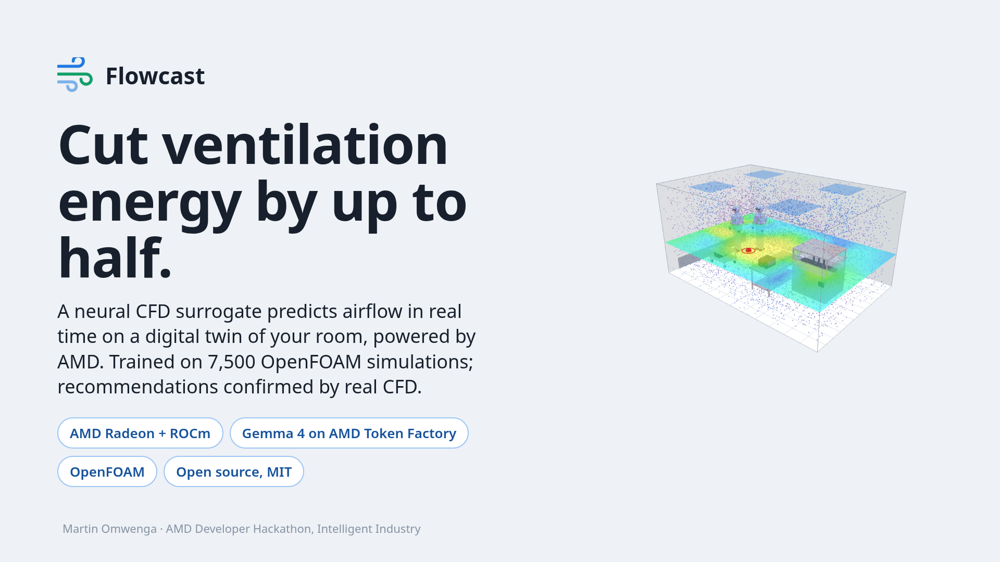
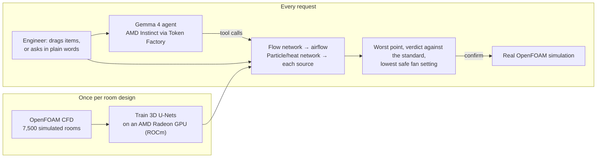

# Flowcast

**Cut ventilation energy by up to half.** A neural CFD surrogate predicts airflow in real time on a
digital twin of the room, powered by AMD, and recommends the lowest fan setting that keeps the room
within its limit. Every recommendation can be confirmed by a real CFD simulation.

**[Live demo](https://100-31-84-106.sslip.io)** · **[Slides](docs/presentation/Flowcast-slides.pdf)** · **[Accuracy report](docs/accuracy.md)** · **[Validation against a real experiment](docs/validation/)**

Built for the AMD Developer Hackathon: ACT III (lablab.ai), **Intelligent Industry** track.



## In one minute

- **The problem.** Cleanrooms, labs and fan-cooled control cabinets run their fans at a fixed, worst-case setting all day. Fan power rises with the cube of airflow, so 20% less air saves about half the fan's power. The fans stay up because predicting what a lower setting does takes a specialist and a CFD study, done once at design time and never repeated as the room changes.
- **Who uses Flowcast.** The engineer responsible for a room: the facilities, process or validation engineer at a pharmaceutical, biotech or electronics plant, or the designer of a control panel. They need no CFD knowledge.
- **What it improves.** Energy use, without giving up the room's cleanliness limit or the components' temperature rating.
- **The measured result.** On both demo rooms the recommended setting was confirmed by a real OpenFOAM simulation:

| Demo room | Runs today at | Flowcast recommends | Confirmed by simulation | Fan power | Saving |
|---|---|---|---|---|---|
| Cleanroom, EU GMP grade C, staffed | 30 air changes an hour | 20.25 | Worst point at 98% of the limit | 1,500 W → 544 W | **64%**, about 8,400 kWh a year |
| Control cabinet, drives rated 50 °C | 1,000 m³/h | 400 m³/h | Hottest air at 85% of the allowed rise | 150 W → 21 W | **86%**, about 1,100 kWh a year |

Fan power is calculated with the cube law, including 8% of losses that do not fall as the fans slow, for continuous running. The baseline powers are stated assumptions; the airflow and the confirmation are measured.

## How it fits the Intelligent Industry brief

| The brief asks for | Flowcast |
|---|---|
| Help a manufacturer **use resources more efficiently, improve quality, increase safety or reduce downtime** | Less fan energy (efficiency), while holding the cleanroom's particle limit (product quality) and the cabinet's temperature rating (overheated drives trip and stop the line: downtime) |
| Work from **industrial data**: machines, sensors, manuals, maintenance records | The plant's layout and equipment, its production plan in plain words, its cleanliness standard (EU GMP Annex 1, ISO 14644-1), typical component heat losses (a datasheet can replace them), and 7,500 CFD simulations of the plant's room designs |
| Produce a useful **alert, explanation, recommendation or action** | **Alert:** "over the limit" or "too close to call", and a low-confidence warning where the model is unsure. **Explanation:** Gemma 4 explains why the worst point is where it is. **Recommendation:** the lowest safe fan setting and the best place for a machine. **Action:** a day's fan schedule built from the production plan |
| Show a **measurable improvement** | 64% and 86% less fan power on the demo rooms, confirmed by simulation; accuracy measured on 1,100 unseen rooms |
| Make clear **who uses it and what result it improves** | See "In one minute" above |
| **AMD technology powers a meaningful part** | The airflow model trains and runs on an AMD Radeon GPU with ROCm; the language agent runs on AMD Instinct GPUs through AMD's Token Factory; the public demo runs on an AMD EPYC processor |

## What it does

- **Predicts the airflow** from the room's layout and fan setting: air velocity, the age of the air, and each source's particle level (or heat, in the cabinet). About 0.05 to 0.13 s per prediction on an AMD Radeon GPU.
- **Holds the room to a named standard:** EU GMP Annex 1 grades (separate limits staffed and empty) and ISO 14644-1 classes, a site minimum fan setting, or a component temperature rating.
- **Recommends the lowest safe fan setting,** then **confirms it** with a real OpenFOAM simulation, stepping the fan up until one passes.
- **Finds the best place for a machine,** by trying it across the floor.
- **Takes requests in plain words.** Gemma 4 plans the steps and calls Flowcast's own tools, so every number in its answer comes from the airflow model, never from the language model.
- **Plans a day.** Paste a production plan; get a fan schedule with lead and clean-up periods, and the day's energy.

Two demos: a **cleanroom** in three ventilation designs (ceiling panels, filter ceiling, cross-flow), and a **fan-cooled control cabinet**, where heat takes the place of particles.

## How the AI is put together



- **Two networks per design.** A flow network maps the layout and fan setting to the airflow. A second network maps one source, plus that airflow, to that source's particle or heat field. Fields add up, so switching a machine off needs no new prediction, and a search can try hundreds of settings in seconds.
- **Scaled so one network covers every fan setting.** Velocity is divided by the supply speed, and particle level is multiplied by the airflow.
- **An ensemble.** Two to four networks per design, trained from different random starts. Their average is the prediction, and their disagreement is the confidence reading on the page.
- **The language model is an operator, not an oracle.** Gemma reads the request, chooses tools (move, add, search, schedule) and writes the answer from what the tools return. If Gemma is unavailable, DeepSeek on the same service takes over, and the page names the model that answered.

## Where AMD hardware is used

| Part | AMD hardware | What it does |
|---|---|---|
| Training and GPU serving | **Radeon RX 6600 with ROCm** (PyTorch) | Trains every network; answers each prediction in about 0.1 s |
| Language agent | **Instinct GPUs via AMD Token Factory** | Runs Gemma 4 (and DeepSeek as fallback) for requests, explanations and day planning |
| Public demo | **EPYC processor** (AWS) | Serves the live site around the clock |

Each prediction on the page is labelled with the hardware that answered it.

## How accurate it is

All figures are measured on rooms the model never saw. "Realistic" rooms are laid out the way
real ones are: machines against walls, people at machines, cabinet components in rows.

| Design | Test rooms | Worst point, median error | Same within-limit verdict as the simulation |
|---|---|---|---|
| Cleanroom, ceiling panels: random / realistic | 267 / 105 | 8.9% / 13.1% | 92% / 98% |
| Cleanroom, filter ceiling | 194 | 4.2% | 98% |
| Cleanroom, cross-flow | 226 | 5.8% | 94% |
| Control cabinet: random / realistic | 240 / 68 | 9.8% / 13.0% | 94% / 94% |

- **A weakness found and fixed.** The first models were about twice as wrong on realistic rooms. We simulated 1,000 realistic rooms, retrained, and closed most of the gap.
- **The simulations themselves are validated.** On the published IEA Annex 20 room experiment, our CFD set-up matches the laser-measured air velocity to within 4.3% of the supply velocity. See [docs/validation](docs/validation/).
- **Why recommendations are confirmed.** At the 15% safety margin used, 81% of the model's recommendations proved safe by simulation on 100 unseen rooms. That is too few to trust alone, so Flowcast confirms its answer with real CFD.

Full method and every figure: [docs/accuracy.md](docs/accuracy.md).

## Business value

- **Proven demand.** Industry already pays to cut cleanroom air: Roche/Genentech runs an air-change-reduction programme, vendors sell airflow-reduction systems, and ISO 14644-16 sets out cleanroom energy efficiency. Lawrence Berkeley National Laboratory measured 60 to 80% fan-energy savings from demand-controlled filtration.
- **Customers.** Pharmaceutical and biotech manufacturing, electronics, hospital pharmacies and laboratories; with the heat version, panel builders and equipment rooms.

| Approach | Limit | Flowcast |
|---|---|---|
| Reactive control (EECO2, Telstar SmartCR): particle counters drive the fans | Sees only where the counters are; finds out after the fact; needs hardware and a retrofit | Predicts the whole room before a change; works alongside a controller |
| A consultant's CFD study | Weeks and a specialist per question; never repeated | Any layout, any fan setting, in a tenth of a second |
| AI twins for chip fabs (TwinFab) | No published accuracy; aimed at the largest sites | Published error, open source, aimed at ordinary cleanrooms and cabinets |

- **Revenue model.** A subscription per room for daily use: change planning, night setback and fan schedules. Each new room design is set up once (simulations and training), and every design widens the library.
- **Where it goes.** Describe a room in plain words or upload a drawing, and Gemma builds its digital twin within the library of trained designs. Then a finer training grid, people who move, and learning from every room confirmed by simulation.

## What is original

- **It predicts before you change anything.** Existing controllers react to sensors after the fact.
- **It checks itself.** Each recommendation can be confirmed by a real CFD run, and the page reports where the model is unsure.
- **It publishes its error,** against both simulation and a laboratory experiment.
- **One pipeline, many spaces.** The same code serves particles in cleanrooms and heat in cabinets; a new room type is a pipeline run, not a new project.

## Run it

You need Python 3.12, Node 22, and for training a GPU supported by PyTorch (ROCm or CUDA).
Simulations need OpenFOAM v2512 natively, or podman or docker to run the `opencfd/openfoam-default:2512` image.

```bash
# the service (put AMD_TOKEN_FACTORY_KEY in .env for the language features)
pip install torch --index-url https://download.pytorch.org/whl/rocm6.4   # or the CPU/CUDA index
pip install -e ".[api]"
uvicorn flowcast.api.app:app --port 8000

# the page
cd web && npm ci && npm run dev

# simulate a batch of rooms, then train and evaluate
python -m flowcast.sim.batch --room panels --count 1500 --out data/cases
python -m flowcast.model.train --task flow --data data/cases --out data/models/flow/0
python -m flowcast.model.train --task particles --data data/cases --out data/models/particles/0
python -m flowcast.model.evaluate --data data/cases --models data/models
```

Or the whole site in one container, with the trained models mounted from `./data`:

```bash
podman build -t flowcast .
podman run --rm -p 8000:8000 --env-file .env -v ./data:/data:ro,z flowcast
```

## Repository

| Folder | Contents |
|---|---|
| `flowcast/sim` | Room designs, layout sampling (random and realistic), OpenFOAM case writing, batch runner, the Annex 20 check |
| `flowcast/model` | Feature scaling, the networks, training, the ensemble, evaluation, the safety-margin study |
| `flowcast/api` | The service: predictions, search, verification, standards, heat, the Gemma agent, explanations, day planning |
| `web` | The site: TypeScript and three.js |
| `docs` | Accuracy report, validation data and chart, slides |
| `deploy/aws` | Scripts to host the demo on one AMD EPYC machine |

## Limits

- It is a screening and planning tool. It does not replace the tests a regulated room must pass.
- Each room design has its own trained models; a new kind of room needs new simulations and training.
- The training grid is coarse (20 cm). It is the largest single source of error, and a finer training set is the next step.
- People are fixed blocks that release particles, heat is left out of the cleanroom, and release rates are assumptions stated on the page.

## Licence

MIT. See `LICENSE`, and `NOTICE.md` for the software, models and data it uses.
